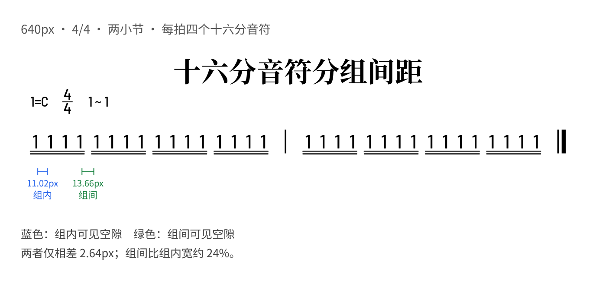

# 音符组间距实测

2026-11-17，使用当前网页 `renderScoreInto`，连续模式、640px版宽、默认22px音符字号及0.5em谱内边距。两小节4/4，每拍四个十六分音符，共32个音符、8组，排在同一谱行。用相同音高排除不同数字字形宽度的干扰；不改网页排版，不重新生成PDF或回写最佳宽度。

[示例谱源](examples/beam-group-spacing-640.m3n)：

```m3n
{title=十六分音符分组间距}{4/4}
N: ((1 1 1 1)) ((1 1 1 1)) ((1 1 1 1)) ((1 1 1 1)) | ((1 1 1 1)) ((1 1 1 1)) ((1 1 1 1)) ((1 1 1 1)) |||
```



| 测量项 | 同组 | 不同组 |
| --- | ---: | ---: |
| 数字实际墨迹之间的空隙 | 11.018607px | 13.658607px |
| 相邻数字中心距离 | 17.018607px | 19.658607px |
| 同类空隙数量 | 24 | 6 |

组间只比组内增加2.64px，可见空隙增加约24%，中心距离增加约15.5%；小节线两侧不计作普通组间空隙。实测使用浏览器Canvas文字墨迹与SVG坐标变换，不把文字的整行盒宽当作可见宽度。PNG按2倍设备像素输出，表中的单位仍是640px谱面的逻辑像素。

最小／自然基础间距分别为0.4／0.6em，按实际时值平方根缩放；同符杠组内弹簧系数为0.6，组间不收紧，另有0.1em最小间距下限。0.6只作用于基础弹簧，不会约束最终可见空隙的比例。以十六分音符为例，自然基础间距为组内3.96px、组间6.6px，差值2.64px；字形本身的左右留白和整行撑满增加的空间会稀释这个比例，因此最终视觉反差明显小于基础弹簧的比例。
