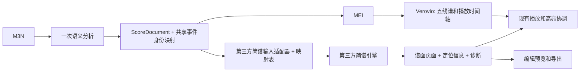

# 简谱绘制质量审视与整改方案

审视日期：2026-10-16。代码基线：`2b4b08f`。本文是选型和整改方案，不代表已完成引擎替换。

## 结论与推荐

建议将简谱的排版、避让和分页交给第三方引擎，M3N 保留语义转换、编辑定位和播放联动。当前问题同时包含**音乐记号遗漏**和**排版能力不足**，仅调整字体、行距、线条粗细无法解决。

推荐分两种产品约束决策：

- **质量优先，可以增加自部署渲染服务：首选验证 jianpu-ly + LilyPond。** 这条路线把歌词间距、连线、符杠和分页交给成熟雕版系统，最符合“不要自己绘制”的目标。代价是增加 Python/LilyPond 运行环境，编辑预览和逐音交互需要另做适配。
- **必须保持浏览器本地渲染：优先验证 jpFun。** 它已有 TypeScript、SVG、中文歌词、多声部、结构化布局和源码范围，接入形态最接近本项目。但实测 `compileScore` 不会根据页面宽度自动拆分长行，默认 SVG 也没有 M3N 事件分组，现阶段不能直接宣布可替换。

暂不建议立刻全量切换。先用相同谱例验证质量和功能，再决定生产引擎；验证失败时保留现状并记录缺口，避免再次维护一份重写的第三方排版器。

## 当前代码的主要问题

### 1. 两种谱面的排版责任不同

五线谱沿 `ScoreDocument → MEI → Verovio` 渲染，主要雕版由 Verovio 完成，应用补充页头、歌词和文字避让。

简谱沿 `ScoreDocument → 本地简谱模型 → layout.ts → renderer.ts → SVG` 渲染。`packages/numbered-notation/src/score.ts` 加上 `core/*.ts` 共约 3,800 行，项目实际承担了字距、节奏对齐、歌词占位、连线、装饰和分页等引擎职责。

核心证据：

| 位置 | 现状 | 影响 |
| --- | --- | --- |
| `core/layout.ts:12–28, 145–160` | 普通音符步长 22.5、短音符步长 15；歌词按 ASCII 半格、其他字符一格估宽，固定格宽约 16.67 | 没有按实际字体测量，中文、英文、标点和长词容易出现间距偏差 |
| `core/layout.ts:859–875` | 通过统一缩放事件横坐标适配行宽 | 字形、歌词和附着记号不随横坐标一起缩小，拥挤时缺少可靠的最小净空约束 |
| `core/renderer.ts:515–530` | 文字指令按字符类别估算 14/7 的宽度 | 避让依赖近似值，字体和内容变化后仍可能碰撞 |
| `score.ts:453–589` | 用自然宽度决定行数，动态规划最小化最宽一行 | 有宽度均衡能力，但目标没有显式包含歌词碰撞、过度压缩或跨行关系代价；也没有最大压缩率限制 |
| `core/config.ts`、`core/renderer.ts` | 字体、谱头、数字路径和不同符号分别使用固定尺寸、比例和坐标补偿 | 缺少统一的字形度量和排版样式体系，调整一个元素容易影响其他元素 |

这里已有许多有效的局部修复，例如和音、低音点、跨行连奏、跳房子和歌词分页；问题在于后续每增加一个音乐功能，项目仍需继续承担相应雕版和组合避让工作。

### 2. 有音乐语义遗漏，优先级高于美化

以下结果通过当前 `parseM3NDocument` 与 `NumberedNotationScore.render` 实际生成 SVG 确认：

| 问题 | 最小验证 | 当前结果 |
| --- | --- | --- |
| 延长号遗漏 | `N: 1 2 3 4 |||` 与 `N: 1{fermata} 2 3 4 |||`，都加 `{4/4}` | 两份 SVG 完全相同 |
| 跳音遗漏 | 上例给第一个音加 `{tip}` | SVG 完全相同 |
| 谱中速度变化遗漏 | `{90qpm}`，第二小节开始改为 `{120qpm}` | 与未变速时的 SVG 完全相同 |
| 八度区间遗漏 | `{8va}1 2 3 4{/}` | 领域事件已有 `octaveShift=1`，简谱未显示八度变化 |
| 多小节休止信息遗漏 | `{rest=2}` | 输出单个 `0`，未显示休止小节数 |
| 重复 DOM ID | `{4/4}\nN: 0^ 1 2 |||` | 长休止拆成两个 `0`，都使用 `id="m3n-e-1"` |

原因可以直接追到适配器：

- `score.ts:62–69` 的装饰白名单未映射 `fermata`、`tip`、`hold`、`str` 等 M3N 后缀，尽管底层字形中存在部分对应记号。
- `note()` 未消费 `event.octaveShift`；`addIntervals()` 仅处理渐强、渐弱和连奏，未处理八度与速度区间。
- 速度只从文档初始元数据投影，未投影事件上的速度变化。
- 多小节休止被转为普通休止占位；长休止的多个可见实例复用同一个唯一 ID。

因此整改必须有明确的支持矩阵：每项音乐语义标记为“完整支持 / 有损支持 / 不支持”，有损或不支持时给出诊断。不能仅凭 SVG 成功生成判断支持。

### 3. 应用层存在功能和维护差距

- `src/components/ScoreExportDialog.tsx` 的“包含低音谱表”参数只传给 Verovio 分支，简谱分支没有接收该参数，而简谱适配器会自动加入低音。界面选项与实际输出不一致。
- `ScoreRenderer.tsx` 在简谱模式仍执行 Verovio 排版并从第一页 SVG 提取音乐字体；简谱的展示和资源初始化没有真正独立。新引擎应提供独立字体资产，Verovio 继续负责播放时间轴。
- 事件 ID 在简谱适配器中按遍历次序重新生成，必须与 MEI 的编号规则保持一致。新增引擎时应共享事件身份映射，避免各后端独立编号。
- PDF 当前经 SVG → Canvas → PNG → jsPDF 输出，简谱和五线谱共用此限制。它影响放大和打印，但不能把它当成简谱独有的差距。引擎迁移后应另验矢量 PDF 导出。

### 4. 测试验证了许多规则，但没有证明整体绘制质量

当前简谱包 **69/69 项测试通过**，仍能复现上述遗漏。现有测试主要检查 SVG 字符串、指定坐标关系、分页和稳定标记；端到端测试覆盖显示、切换和播放联动，未建立截图基准。

需要补充音乐语义覆盖、字体就绪后的实际字形边界检查，以及人工确认的视觉基准。不能以“页面出现 SVG、音符有 ID”作为排版质量验收。

## 第三方方案比较

先读了本地 `docs/`；其中没有第三方简谱选型资料，随后检查了上游 README、源码和 npm 发布物。以下版本和状态为审视日所见，不代表已完成全谱库兼容验证。

| 方案 | 接入和输出 | 已确认的优势 | 主要缺口 | 建议 |
| --- | --- | --- | --- | --- |
| [jianpu-ly + LilyPond](https://github.com/ssb22/jianpu-ly) | Python 将简谱脚本转为 LilyPond，再生成 SVG/PDF；转换器 Apache-2.0，LilyPond GPL | 文档列出中文歌词、多声部、和音、倚音、连音组、力度、反复、房子和多小节休止；复用 LilyPond 雕版 | 当前 Worker 不能直接运行这套进程，需要外部容器服务；实时延迟和音符定位待验证 | **质量优先的首选验证对象** |
| [jpFun 0.6.0](https://github.com/madderscientist/jpFun/tree/main/packages/jpfun) | npm、ESM、TS，直接生成多页 SVG；Apache-2.0 | 已实跑中文歌词和双声部；可传 Canvas 字体测量器；布局对象保留源码范围和边界 | 普通编译缺少按宽度自动分行；SVG 无现成事件 ID 分组；完整 M3N 语义和跨行表现待验证 | **纯前端的首选验证对象** |
| [abc2svg 1.22.1 的 jianpu 模块](https://www.npmjs.com/package/abc2svg) | 加载 `abc2svg-1.js` 和 `jianpu-1.js`，输入 ABC，输出 SVG；LGPL-3.0，源码标注 LGPL3+ | 发布物确实包含简谱模块，实跑中文歌词和按宽度自动分行成功 | 简谱模块绕过默认音符绘制，实测没有 note/rest 的 `anno_start` 回调；中文度量、页头及整套记号效果待验；集成时需满足许可证条件 | 作为具备自动分行能力的对照候选 |
| [Sparks NMN](https://github.com/yezhiyi9670/sparks-notation-1) | 浏览器 TS 核心，返回 DOM 分段；Apache-2.0 | 有中文歌词、多声部、分页和点击定位接口，适合完整制谱应用 | 官方说明未单独打包核心；跨 workspace 引用，输出不是现有 `string[]` SVG 契约，需要重做展示和导出适配 | 备选，接入范围大于单纯替换 SVG 引擎 |
| [open-fanqie](https://github.com/Linho1219/open-fanqie) | TS 核心，番茄简谱 DSL / 结构化模型 → SVG；MIT | 与本项目现有模型接近，迁移成本相对低 | 当前代码已经高度同源；上游明确记录细分节拍对齐和 6/8 减时线分组等问题；审视时 npm 未找到 `@openfanqie/core` | 可用于收回 fork 维护成本，**不应视为质量升级方案** |
| [JianpuRender 1.8.1](https://github.com/flufy3d/jianpurender) | npm，按时间点的音符/歌词数据 → SVG；Apache-2.0 | 点击、高亮、变速和 SVG 导出接口明确，结构化数据容易投影 | 公开输入类型未表达反复、房子、力度、倚音、独立多声部和多段歌词等现有能力 | 更适合播放教学视图，不能直接承接完整谱面 |
| [simple-notation 1.0.27](https://github.com/Encaik/simple-notation) | npm，文本音符与歌词 → SVG；MIT | 上手简单，有响应式布局和光标接口 | 尚未证实能够完整覆盖本项目的反复、多声部、和音与多段歌词，不能仅按示例判定可替换 | 不列入首轮迁移 |

### 为什么“直接接回 open-fanqie”不够

本地保留 `Copyright (c) 2024 Linho` 的 MIT 文本。对审视日上游 `68e2296864aee833f76f8461fee24b9a0edeec3c` 做行级比较，`layout.ts` 相似度约 **97%**，`renderer.ts` 约 **66%**，其他辅助文件也高度相似；计算使用 `SequenceMatcher(..., autojunk=False)`，不是功能质量评分。

这意味着当前工程并非完全没有复用第三方成果，而是维护了大量本地改造。接回同一引擎可以减少维护分叉，但上游本身不足以自动解决现有质量差距，还必须迁移回 M3N 增加的歌词、交互和避让能力。

### 实跑结果与选型边界

- **jpFun**：直接调用 0.6.0 发布物的 `compileScore` 和 `renderLayoutPagesToSvg`，中文歌词和双声部输出成功，无编译及布局诊断。
- **jpFun 长行**：`@page(width=320px)` 后输入 32 次 `1 2 3 4 |`，`lineCount` 仍为 1；128 个音符中，按顺序检查相邻包围盒有 127 对相交，且诊断为空。MIDI 导入器内部另有自动分行逻辑，不能据此推断普通脚本编译也支持自动分行。
- **abc2svg**：加载发布物中的简谱模块，`%%jianpu 1`、中文歌词和 800px 页面成功生成数字谱面。320px 下 4 小节输出 3 个 SVG 块、32 小节输出 17 个，无错误；SVG 块包含谱头等内容，数量不等同于纸张页数。
- **abc2svg 定位**：仅音符/小节线谱例的 `anno_start` 回调种类只有 `bar`；加入歌词后有 `lyrics`。不能把常规五线谱模式的回调能力直接当作简谱模式的能力。
- 使用无服务的 Chromium `setContent` 对生成结果做了静态目视检查；样例用于验证能力，内容和默认样式不同，不能作为同谱面美观评分。
- 本环境没有 LilyPond，因此 jianpu-ly 路线本次只完成文档评估，没有实测雕版速度、SVG 定位或本项目完整谱库。

## 目标架构

适配器消费规范化语义，不通过正则把 M3N 原文直接替换为另一套 DSL，也不使用 MIDI 中转承载版面语义。后两种方式难以保留歌词、反复、装饰和源码对应关系。

保留 `@m3n/numbered-notation` 作为后端适配边界，具体第三方类型不进入 `@m3n/notation`。页面应能获取：页面输出、每个音乐事件对应的可见元素或边界、诊断、后端名称和版本。浏览器与服务端后端均按异步接口调用，并支持取消和过期结果丢弃。

映射关系必须允许一个事件对应多个图形实例，例如长音增时线、跨行延音、连音组子音符，以及反复中的多次播放。唯一 DOM ID 与可以重复的 `data-m3n-id` 分开管理。

### jianpu-ly 服务路线

建议 `ScoreDocument → 生成的 jianpu-ly 输入 + 事件映射 → 自部署容器 → SVG/PDF`。Worker 负责转发和缓存入口，Python/LilyPond 在独立容器中运行。缓存键包含语义内容、纸张/字体配置和两个引擎版本；渲染设置、作业资源上限和所用字体由服务控制。

首次验证必须解决逐音锚点或源码坐标回传。只有 PDF 或整页 SVG 而无法恢复音符位置，不满足当前编辑器要求；若仅印刷通道先通过，可先作为明确的印刷后端上线，不能声称完成了网页简谱替换。

### jpFun 浏览器路线

使用 `compileScore`、`CanvasTextMeasurer` 和 SVG 输出，等字体加载完成后再测量。将生成脚本的 source span 映射回共享事件 ID，并从第三方布局对象建立交互定位层；这里适配的是交互，不重写音符字形或关系线。

自动分行是准入条件。优先要求上游提供公共分行能力；如果最终需要项目自己维护分行、避让和跨行关系等算法，就不符合此次降低绘制维护成本的目标，应停止该路线或明确重新评估范围。

## 实施顺序与验收

以下是单人实施的初步量级，非工期承诺；完整语义适配和服务部署成本需在 PoC 后修订。

| 阶段 | 交付物 | 通过条件 | 初步量级 |
| --- | --- | --- | --- |
| P0：建立基线 | 语义支持矩阵、同谱截图、点击/播放映射基准；先为已复现遗漏建立失败用例，再修复遗漏和重复 ID | 音乐语义无静默丢失，事件身份唯一且能映射；不继续扩展本地排版算法 | 2–4 个工作日 |
| P1：第三方对比 PoC | jianpu-ly 与 jpFun 使用同一批谱例；以 abc2svg 验证自动分行替代方向 | 完成文字测量、密集小节、歌词/声部、分行分页、定位与导出；明确服务路线或浏览器路线 | 3–5 个工作日 |
| P2：适配与灰度 | 共享事件映射、独立字体、统一预览/导出路径、后端切换、错误诊断；必要时部署服务 | 下述验收矩阵通过，旧引擎可回退，接口不泄漏到领域层 | 约 1–3 周，PoC 后重估 |
| P3：替换完成 | 默认第三方后端，移除旧核心及为其服务的局部补偿 | 全谱库通过，复杂谱例人工签收；线上回退观察结束 | 取决于 P2 结果 |

验收至少覆盖：

1. **语义**：音高/八度/变音、全范围时值、休止/多小节休止、和音/低音、倚音、连音组、延音/连奏、力度/发夹/文字形式、装饰、变调/变拍/变速、反复/房子/导航、全部歌词行与遍次归属、强制换行。
2. **排版**：320/600/800/1000px 和 A4；长词、中文标点、低音点加多层减时线、和音、连奏与房子同处一行、跨系统关系。不能出现超出版心、歌词相叠或记号压住音符；应重排而非无限压缩。
3. **交互**：点击音符和歌词定位、源码选中高亮、连音组和长音分解后的多元素高亮、低音以及 DS/反复后正确歌词行高亮。
4. **导出**：预览与最终产物使用同一次布局和字体；包含/排除低音有效；PDF 分页不裁剪、不缺字，分别验证矢量和栅格输出。
5. **维护**：固定第三方版本、保留许可和字体声明、明确升级流程；新增音乐功能主要修改语义适配，不再新增自有绘制算法。
6. **性能**：在代表性设备记录短谱、百小节谱与完整曲库的首次加载和编辑重排耗时、缓存命中及内存。先量化后设阈值；服务路线额外记录队列和网络耗时。

第一轮建议选《欢乐颂》《童话镇》《新不了情》《土耳其进行曲》以及独立的 6/8、多段歌词、低音和音、跨行连线、跳房子、变速、多小节休止用例；通过后再扩大到全部内置谱库。

## 本次验证记录与资料

- `npm run test -w @m3n/numbered-notation`：1 个测试文件、69 项通过。
- 使用项目解析器和简谱源码执行最小 SVG 对比，确认装饰/变速遗漏、八度遗漏、多小节休止未显示数量及重复 ID。
- 第三方 npm 发布物下载到临时目录解包验证，未改动生产依赖；未启动开发服务器。
- [jianpu-ly 官方功能和输入说明](https://github.com/ssb22/jianpu-ly#readme)。
- [LilyPond 官方介绍与文档](https://lilypond.org/introduction.html)。
- [jpFun 发布物与版本](https://www.npmjs.com/package/jpfun/v/0.6.0)、[语法与页面/关系说明](https://github.com/madderscientist/jpFun/blob/main/packages/jpfun/grammar.md)。
- [abc2svg 发布物](https://www.npmjs.com/package/abc2svg/v/1.22.1)，本次实际检查了其中的 `jianpu-1.js`，未将旧 GitHub 镜像当作最新发布内容。
- [open-fanqie 的已知问题与许可证边界](https://github.com/Linho1219/open-fanqie/tree/68e2296864aee833f76f8461fee24b9a0edeec3c#readme)。
- [Sparks NMN 构建与核心复用说明](https://github.com/yezhiyi9670/sparks-notation-1#readme)。

源码行号用于定位审视基线，后续重构可能变化；第三方优势中未实跑的部分依据上游文档，最终以同谱例验收为准。
